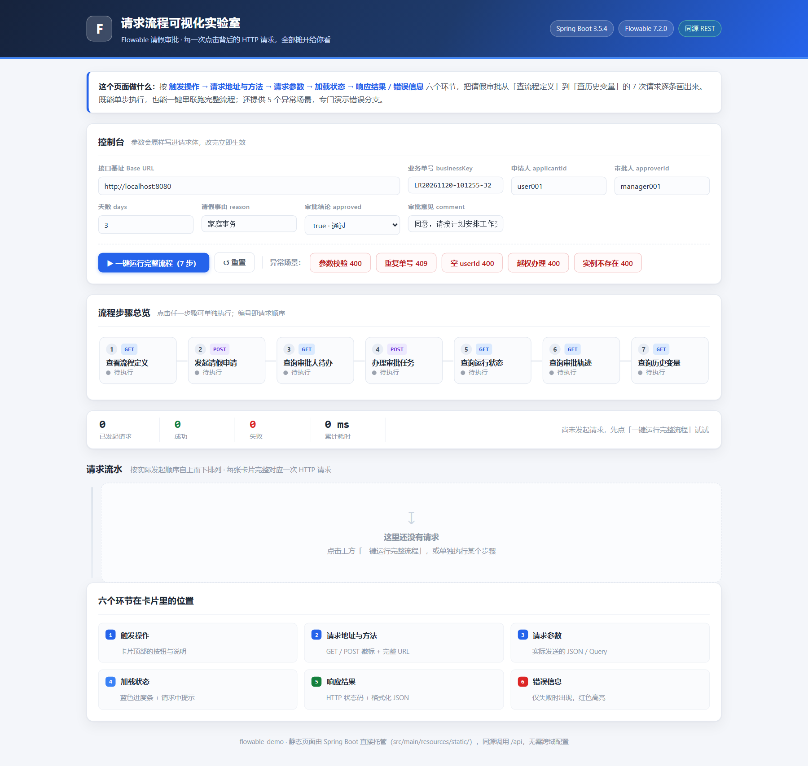
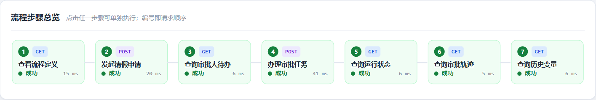
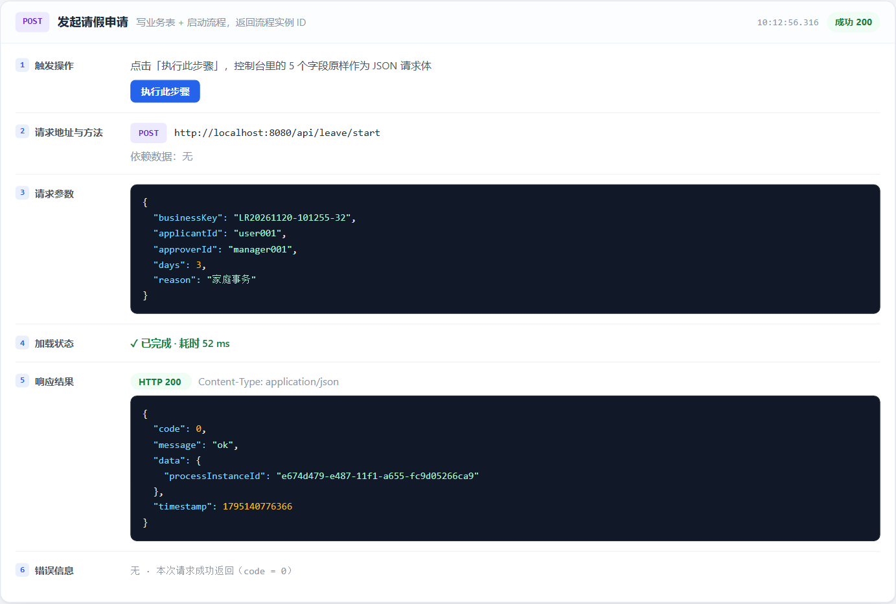
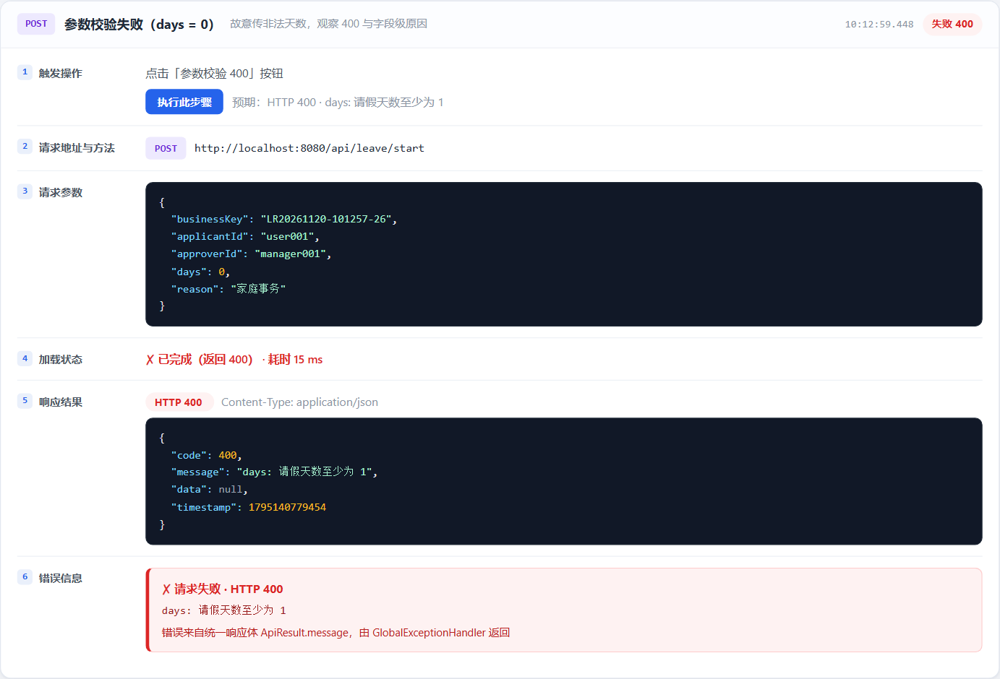
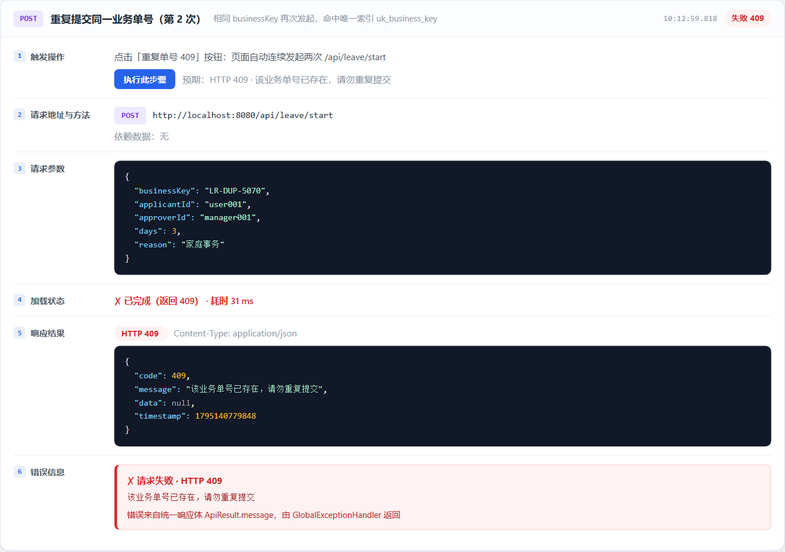

# Spring Boot 3 整合 Flowable 7 实战：从零搭一套可运行的请假审批流程

这篇不是把 API 文档抄一遍。我在 JDK 17 + Spring Boot 3.5.4 + Flowable 7.2.0 + MySQL 8 的环境里完整搭了一遍：建库、写 BPMN、配自动部署、发起流程、查待办、审批通过、审批驳回、查历史轨迹，把过程中暴露的并发重复提交、发起人丢失、参数错误返 500 三个问题修掉，最后跑了 29 项端到端断言。全部在本机真实编译、启动、发请求、查库验证过。

文末附完整工程结构，代码可直接运行。

## 1、先定版本基线：为什么是 3.5.4 + 7.2.0

结论先给：

| 组件 | 本文版本 | 用途 |
| --- | --- | --- |
| JDK | 17.0.12 | 运行环境 |
| Spring Boot | 3.5.4 | 应用框架 |
| Flowable | 7.2.0 | BPMN 流程引擎 + Spring Boot Starter |
| MySQL | 8.0.45 | 持久化业务表与 `ACT_*` 引擎表 |
| Maven | 3.9.3 | 构建 |

这个组合不是随手选的。查 Flowable 官方 GitHub Releases 可以确认两条关键事实：

- **Flowable 7.2.0**（2025-08-21）的 Release Notes 里有一条 `Upgrade to Spring Boot 3.5.4`；
- **Flowable 8.0.0** 的 Breaking Changes 明确写着：`Flowable 8 is now based on Spring Framework 7 and Spring Boot 4. There is no support for Spring Boot 3 anymore.`

也就是说，Spring Boot 3 项目应该用 7.2.0，把 8.x 拽进来会直接踩到 Spring 7 / Jackson 3 的不兼容。反过来，7.2.0 的元数据基线就是 3.5.4，所以本文不擅自升到其它 3.5.x 补丁版本——要升必须重新跑一遍完整回归。

### 1.1 实测依赖树

`mvn dependency:tree` 的关键输出：

```text
[INFO] +- org.springframework.boot:spring-boot:jar:3.5.4:compile
[INFO] +- org.flowable:flowable-spring-boot-starter-process:jar:7.2.0:compile
[INFO] |  \- org.flowable:flowable-engine:jar:7.2.0:compile
[INFO] +- com.mysql:mysql-connector-j:jar:9.3.0:runtime
```

有个容易心里一咯噔的点：Boot 3.5.4 的 BOM 把 MySQL 驱动管到了 **Connector/J 9.3.0**，不是 8.x。实测连 MySQL 8.0.45 服务端完全正常，不需要手动降版本，也不要在 pom 里自己写死版本。

### 1.2 只引 process starter

常规 BPMN 审批只需要 `flowable-spring-boot-starter-process`，它会传递引入 `flowable-engine` 和所需自动配置。不要一上来就引聚合的 `flowable-spring-boot-starter`，那会把 CMMN、DMN、Event Registry 等用不到的引擎一起拖进来。

> 实测启动日志里确实出现了 `SpringEventRegistryConfigurator` 和 `IdmEngineConfigurator`，并额外建了一批 `flw_*` / `act_id_*` 表——这是 7.2.0 process starter 自带的引擎配置器行为，不影响 BPMN 功能，不用手动排除。

## 2、先分清五个核心概念

工作流教程最容易劝退人的地方，是几个名词长得太像。先把它们钉死：

| 概念 | 含义 | 本文里的例子 |
| --- | --- | --- |
| Process Definition | 流程定义，可反复启动的模板 | `leaveApproval:1:xxx` |
| Deployment | 一次部署记录，保存资源与版本 | 启动时自动部署的 BPMN 文件 |
| Process Instance | 按定义启动的一次具体运行 | 张三的一次请假申请 |
| Task | 需要人工办理的任务实例 | 部门经理待审批的那条 |
| Process Variable | 流程运行期间的数据 | `approverId`、`days`、`approved` |

一句话串起来：**部署**把 BPMN 变成**流程定义**，按定义**启动**得到**流程实例**，实例走到 User Task 生成**待办任务**，办理时写入**流程变量**决定网关往哪走。

对应的 Flowable 服务：

| 服务 | 职责 |
| --- | --- |
| `RepositoryService` | 部署流程定义、查询定义与部署资源 |
| `RuntimeService` | 启动、查询运行实例，管理运行变量 |
| `TaskService` | 查询、认领、完成任务 |
| `HistoryService` | 查询历史实例、任务轨迹、历史变量 |
| `IdentityService` | 设置认证用户（决定历史里的发起人） |
| `ManagementService` | 作业、异步执行器、表管理等 |

这些服务由 starter 自动装配，直接用构造器注入即可，不需要自己 `buildProcessEngine()`。

## 3、流程设计：一条请假审批主线

示例流程固定为四步：

| 步骤 | 节点 | 说明 |
| --- | --- | --- |
| 1 | 开始事件 | 员工提交申请，传入申请人、审批人、天数、事由 |
| 2 | 部门经理审批 | 引擎创建分配给 `approverId` 的用户任务 |
| 3 | 排他网关 | 按 `approved` 布尔变量选分支 |
| 4A / 4B | 通过 / 驳回 | 各走一个结束事件，流程结束 |

架构上是「业务系统调用嵌入式引擎」：Spring MVC 收请求 → 业务 Service 校验并调 Flowable API → MySQL 同时存业务表与 `ACT_*` 表。

### 3.1 业务数据与流程数据必须分表

这是很多新手项目后期最难改的一个决定。正确做法是：

- `leave_request` 业务表存请假单详情、申请人、天数、业务状态；
- `ACT_*` 引擎表由 Flowable 全权管理，**不要手工改、不要加字段、不要直接删运行记录**；
- 两者通过 `businessKey`（业务单号）和 `processInstanceId` 关联。

本文把业务单号直接作为 `businessKey` 传给引擎，后面查状态、查历史、做幂等都靠它。

## 4、创建工程与依赖配置

`pom.xml` 关键部分：

```xml
<parent>
    <groupId>org.springframework.boot</groupId>
    <artifactId>spring-boot-starter-parent</artifactId>
    <version>3.5.4</version>
    <relativePath/>
</parent>

<properties>
    <java.version>17</java.version>
    <flowable.version>7.2.0</flowable.version>
</properties>

<dependencies>
    <dependency>
        <groupId>org.springframework.boot</groupId>
        <artifactId>spring-boot-starter-web</artifactId>
    </dependency>
    <dependency>
        <groupId>org.springframework.boot</groupId>
        <artifactId>spring-boot-starter-validation</artifactId>
    </dependency>
    <dependency>
        <groupId>org.springframework.boot</groupId>
        <artifactId>spring-boot-starter-jdbc</artifactId>
    </dependency>
    <dependency>
        <groupId>org.flowable</groupId>
        <artifactId>flowable-spring-boot-starter-process</artifactId>
        <version>${flowable.version}</version>
    </dependency>
    <dependency>
        <groupId>com.mysql</groupId>
        <artifactId>mysql-connector-j</artifactId>
        <scope>runtime</scope>
    </dependency>
    <dependency>
        <groupId>org.springframework.boot</groupId>
        <artifactId>spring-boot-starter-test</artifactId>
        <scope>test</scope>
    </dependency>
</dependencies>
```

比参考文档多了一个 `spring-boot-starter-jdbc`：因为本文要落一张业务表做幂等，用 `JdbcTemplate` 最轻。如果只做纯流程演示，可以去掉它和 `schema.sql`。

启动类没有任何特殊注解，标准写法即可：

```java
@SpringBootApplication
public class FlowableDemoApplication {
    public static void main(String[] args) {
        SpringApplication.run(FlowableDemoApplication.class, args);
    }
}
```

## 5、准备 MySQL 数据库

先手工建库（这一步需要 DBA 权限，应用启动时做不了）：

```sql
CREATE DATABASE IF NOT EXISTS flowable_demo
    DEFAULT CHARACTER SET utf8mb4
    COLLATE utf8mb4_0900_ai_ci;
```

生产环境建议同时建一个最小权限账号，别让应用用 root 跑：

```sql
CREATE USER IF NOT EXISTS 'flowable_app'@'localhost' IDENTIFIED BY 'ChangeThis_StrongPassword';
GRANT SELECT, INSERT, UPDATE, DELETE, CREATE, ALTER, INDEX, DROP
    ON flowable_demo.* TO 'flowable_app'@'localhost';
FLUSH PRIVILEGES;
```

### 5.1 两类表由应用自动创建

| 表 | 谁创建 | 怎么触发 |
| --- | --- | --- |
| `leave_request` 业务表 | 应用 | `spring.sql.init.mode=always` 执行 `resources/schema.sql` |
| `ACT_*` 引擎表 | Flowable | `flowable.database-schema-update=true` |

实测首次启动后库里出现 **47 张**表，包括 `ACT_RE_PROCDEF`、`ACT_RU_TASK`、`ACT_RU_EXECUTION`、`ACT_HI_PROCINST`、`ACT_HI_TASKINST`、`ACT_HI_VARINST`，以及 IDM / Event Registry 相关的 `act_id_*`、`flw_*`。启动日志能看到逐条 `performing create on ...`。

> `database-schema-update=true` 只适合本地开发和首次验证。生产必须改成 `false`，按对应版本的升级脚本做受控变更，应用账号只保留 DML 权限。

## 6、编写 application.yml

完整配置：

```yaml
server:
  port: 8080

spring:
  application:
    name: flowable-demo
  datasource:
    url: jdbc:mysql://127.0.0.1:3306/flowable_demo?useUnicode=true&characterEncoding=UTF-8&serverTimezone=Asia/Shanghai&useSSL=false&allowPublicKeyRetrieval=true
    username: ${DB_USER:root}
    password: ${DB_PASSWORD:123456}
    driver-class-name: com.mysql.cj.jdbc.Driver
    hikari:
      maximum-pool-size: 20
      minimum-idle: 5
      connection-timeout: 30000
  sql:
    init:
      mode: always
      schema-locations: classpath:schema.sql

flowable:
  database-schema-update: true
  history-level: audit
  async-executor-activate: false
  process-definition-location-prefix: classpath*:/processes/
  process-definition-location-suffixes: '**.bpmn20.xml,**.bpmn'

logging:
  level:
    org.flowable: info
  charset:
    console: UTF-8
```

### 6.1 逐项说明

| 配置 | 作用 |
| --- | --- |
| `database-schema-update: true` | 允许引擎自动建/升级 `ACT_*` 表 |
| `history-level: audit` | 保存流程实例、活动、任务、变量历史 |
| `async-executor-activate: false` | 示例无定时器和异步节点，先关掉；用了异步 Service Task 再打开 |
| `process-definition-location-prefix` | 自动部署扫描目录 `classpath*:/processes/` |
| `process-definition-location-suffixes` | 扫描后缀，逗号分隔 |
| `spring.sql.init.mode: always` | 每次启动执行业务表 DDL（`CREATE TABLE IF NOT EXISTS`，可重复） |
| `logging.charset.console: UTF-8` | Windows 控制台中文日志不乱码，CMD 下另需 `chcp 65001` |

账号密码用 `${DB_USER:root}` / `${DB_PASSWORD:123456}` 占位，本机直接跑，切换专用账号时只改环境变量，不改配置文件：

```powershell
$env:DB_USER = "flowable_app"
$env:DB_PASSWORD = "你的口令"
```

### 6.2 坑：YAML 单引号必须闭合

参考文档原稿里这一行是这样的：

```yaml
process-definition-location-suffixes: '**.bpmn20.xml,**.bpmn
```

**开头有单引号、结尾没有**。YAML 解析到行尾发现引号标量没闭合，会直接报扫描错误，或者被解析成非预期的值，表现是「BPMN 扫不到 / 启动失败」。本文修正为两端都有引号：

```yaml
process-definition-location-suffixes: '**.bpmn20.xml,**.bpmn'
```

这类错误发生在配置绑定阶段，日志里不会有「文件不存在」之类的友好提示，排查时优先看 application.yml 本身。

## 7、设计 BPMN 2.0 流程文件

放在 `src/main/resources/processes/leave-approval.bpmn20.xml`：

```xml
<?xml version="1.0" encoding="UTF-8"?>
<definitions xmlns="http://www.omg.org/spec/BPMN/20100524/MODEL"
             xmlns:xsi="http://www.w3.org/2001/XMLSchema-instance"
             xmlns:flowable="http://flowable.org/bpmn"
             targetNamespace="http://example.com/flowable">

    <process id="leaveApproval" name="请假审批流程" isExecutable="true">

        <startEvent id="startEvent" name="提交申请"/>
        <sequenceFlow id="flow1" sourceRef="startEvent" targetRef="managerApprove"/>

        <userTask id="managerApprove" name="部门经理审批" flowable:assignee="${approverId}"/>
        <sequenceFlow id="flow2" sourceRef="managerApprove" targetRef="approvalGateway"/>

        <exclusiveGateway id="approvalGateway" name="审批结果"/>

        <sequenceFlow id="approvedFlow" sourceRef="approvalGateway" targetRef="approvedEnd">
            <conditionExpression xsi:type="tFormalExpression"><![CDATA[${approved == true}]]></conditionExpression>
        </sequenceFlow>
        <sequenceFlow id="rejectedFlow" sourceRef="approvalGateway" targetRef="rejectedEnd">
            <conditionExpression xsi:type="tFormalExpression"><![CDATA[${approved == false}]]></conditionExpression>
        </sequenceFlow>

        <endEvent id="approvedEnd" name="审批通过"/>
        <endEvent id="rejectedEnd" name="审批驳回"/>
    </process>
</definitions>
```

### 7.1 关键字段

| 字段 | 含义 |
| --- | --- |
| `process id="leaveApproval"` | 流程定义 Key，启动时 `startProcessInstanceByKey("leaveApproval", ...)` 用的就是它，写错会报 `No process definition` |
| `isExecutable="true"` | 标识可执行流程，漏了部署后无法启动 |
| `flowable:assignee="${approverId}"` | 从流程变量动态取审批人，所以启动流程时**必须**传 `approverId` |
| `exclusiveGateway` | 排他网关，按出线条件选且只选一条 |
| `${approved == true}` / `${approved == false}` | 两条出线的条件，变量必须是 Boolean |

### 7.2 网关最容易踩的两个坑

一是 **`approved` 变量没传或类型不对**，引擎会报「无出线可走」。所以办理任务时要显式写入布尔变量；二是**两条出线都写了条件、没有默认流**，只要变量齐全就没问题，但如果以后加分支，记得给一条留默认出线做兜底。

另外，条件表达式里用 `CDATA` 包一层是必要的，避免 XML 把 `<`、`&&` 之类字符当标签解析。

## 8、启动验证：自动建表与自动部署

```bash
cd D:\project\flowable-demo
mvn clean package -DskipTests
java -jar target/flowable-demo-1.0.0.jar
```

实测启动约 6.5 秒，日志里三处关键信息：

```text
o.f.e.impl.db.ProcessDbSchemaManager : performing create on engine with resource org/flowable/db/create/flowable.mysql.create.engine.sql
o.f.e.impl.db.ProcessDbSchemaManager : Found MySQL: majorVersion=8 minorVersion=0

o.f.s.c.DefaultAutoDeploymentStrategy : Deploying resources [URL [jar:nested:/.../!BOOT-INF/classes/!/processes/leave-approval.bpmn20.xml]] for engine ... deployment name hint SpringBootAutoDeployment

c.e.f.FlowableDemoApplication : Started FlowableDemoApplication in 6.555 seconds (process running for 6.873)
```

第二条是重点：`SpringBootAutoDeployment` 扫到了 jar 包里的 BPMN 并完成部署。注意路径是 **jar 内部**的 `BOOT-INF/classes/processes/`，所以文件必须放在 `src/main/resources/processes/`，放错目录不会被扫到。

启动后先别急着发流程，用接口确认部署结果：

```bash
curl http://localhost:8080/api/process/definitions
```

实测返回：

```json
{"code":0,"message":"ok","data":[{"processDefinitionId":"leaveApproval:1:...","key":"leaveApproval","name":"请假审批流程","version":1,"deploymentId":"...","resourceName":"leave-approval.bpmn20.xml","suspended":false}],"timestamp":...}
```

同一个 Key 多次部署会累加 version，启动实例默认用最新版本，已经跑起来的实例仍绑定它启动时的那一版。

## 9、业务表与幂等：解决并发重复提交

参考文档的示例是「先查有没有运行中的实例，再启动」。作者自己也注明了：**这挡不住并发**——两个请求同时通过预检查，就会生成两个流程实例。

本文改成数据库唯一约束兜底。业务表 DDL：

```sql
CREATE TABLE IF NOT EXISTS leave_request (
    id                  BIGINT       NOT NULL AUTO_INCREMENT,
    business_key        VARCHAR(64)  NOT NULL,
    applicant_id        VARCHAR(64)  NOT NULL,
    approver_id         VARCHAR(64)  NOT NULL,
    days                INT          NOT NULL,
    reason              VARCHAR(512) NOT NULL,
    process_instance_id VARCHAR(64)  NULL,
    status              VARCHAR(20)  NOT NULL DEFAULT 'RUNNING',
    created_at          DATETIME     NOT NULL DEFAULT CURRENT_TIMESTAMP,
    PRIMARY KEY (id),
    UNIQUE KEY uk_business_key (business_key),
    KEY idx_process_instance_id (process_instance_id)
) ENGINE = InnoDB DEFAULT CHARSET = utf8mb4 COLLATE = utf8mb4_0900_ai_ci;
```

发起流程时三步放在同一个事务里：

```java
@Transactional
public String start(StartLeaveRequest request) {
    // 1. 先插业务表：唯一键冲突直接抛 DuplicateKeyException
    leaveRequestRepository.insert(request);

    Map<String, Object> variables = new HashMap<>();
    variables.put("applicantId", request.applicantId());
    variables.put("approverId", request.approverId());
    variables.put("days", request.days());
    variables.put("reason", request.reason());

    // 2. 启动流程，businessKey 直接用作业务关联键
    ProcessInstance instance;
    try {
        identityService.setAuthenticatedUserId(request.applicantId());
        instance = runtimeService.startProcessInstanceByKey(
                "leaveApproval", request.businessKey(), variables);
    } finally {
        identityService.setAuthenticatedUserId(null);
    }

    // 3. 回写流程实例 ID
    leaveRequestRepository.updateProcessInstanceId(request.businessKey(), instance.getId());
    return instance.getId();
}
```

### 9.1 三个细节

第一，**业务表写入与引擎调用共用同一个 `DataSource` 和事务管理器**，所以任何一步失败会一起回滚，不会出现「有业务单但没流程」或反过来。

第二，`identityService.setAuthenticatedUserId(applicantId)` 决定了 `ACT_HI_PROCINST.START_USER_ID_` 有没有值。不设置的话，历史查询里 `startUserId` 是 null。它是 ThreadLocal，用完必须在 `finally` 里清空，否则线程复用会串号。

第三，`DuplicateKeyException` 交给全局异常处理映射成 HTTP 409，前端能明确知道是重复提交，而不是看到一个 500。

## 10、Service 层：待办、审批与历史查询

### 10.1 请求 DTO 用 record + 校验注解

```java
public record StartLeaveRequest(
        @NotBlank @Size(max = 64) String businessKey,
        @NotBlank @Size(max = 64) String applicantId,
        @NotBlank @Size(max = 64) String approverId,
        @Min(1) @Max(365) int days,
        @NotBlank @Size(max = 512) String reason
) {}
```

### 10.2 查询待办

BPMN 用的是 `assignee` 直接分配，所以用 `taskAssignee` 查：

```java
@Transactional(readOnly = true)
public List<TaskVO> listMyTasks(String userId) {
    if (!StringUtils.hasText(userId)) {
        throw new IllegalArgumentException("userId 不能为空");
    }
    return taskService.createTaskQuery()
            .taskAssignee(userId).active()
            .orderByTaskCreateTime().desc()
            .list().stream()
            .map(t -> new TaskVO(t.getId(), t.getName(), t.getProcessInstanceId(),
                    t.getAssignee(), t.getCreateTime()))
            .toList();
}
```

如果改成 `flowable:candidateGroups="MANAGER"` 候选组，查询要换成 `taskCandidateGroup("MANAGER")`，办理前还要先 `taskService.claim(taskId, userId)`，两者不能混用。

### 10.3 办理审批

```java
@Transactional
public void completeTask(String taskId, ApprovalRequest request) {
    Task task = taskService.createTaskQuery()
            .taskId(taskId)
            .taskAssignee(request.operatorId())
            .active()
            .singleResult();
    if (task == null) {
        throw new IllegalArgumentException("任务不存在、已办理或当前用户无权办理");
    }

    Map<String, Object> variables = new HashMap<>();
    variables.put("approved", request.approved());
    variables.put("approvalComment",
            request.comment() == null ? "" : request.comment());
    variables.put("approvedBy", request.operatorId());

    taskService.complete(taskId, variables);

    leaveRequestRepository.updateStatusByProcessInstanceId(
            task.getProcessInstanceId(),
            request.approved() ? "APPROVED" : "REJECTED");
}
```

`taskService.complete()` 一执行，引擎立刻计算排他网关条件，走对应结束事件，运行实例从 `ACT_RU_*` 移除，历史留在 `ACT_HI_*`。

**权限提醒**：`operatorId` 由前端传入只适合教程演示。生产项目必须从 Principal / JWT 里取当前用户 ID，否则攻击者可以伪造审批人。本文用 `taskAssignee` 做了基本限定，但这不等于完整的认证授权。

### 10.4 运行状态与历史查询

```java
ProcessInstance running = runtimeService.createProcessInstanceQuery()
        .processInstanceId(processInstanceId).singleResult();
HistoricProcessInstance historic = historyService.createHistoricProcessInstanceQuery()
        .processInstanceId(processInstanceId).singleResult();
```

`running != null` 表示流程还在跑；一旦到达结束事件，运行实例被删除，只能从 `HistoryService` 查。历史任务轨迹和历史变量同理：

```java
historyService.createHistoricTaskInstanceQuery()
        .processInstanceId(id)
        .orderByHistoricTaskInstanceStartTime().asc().list();

historyService.createHistoricVariableInstanceQuery()
        .processInstanceId(id).list();
```

历史级别会限制可查范围。本文 `audit` 足够覆盖常规审批轨迹；要更完整的活动级记录再评估 `full`，但要注意数据量。

## 11、统一响应与异常处理：把 500 变成 4xx

参考文档的 Controller 直接返回 `Map` 和 `List`，一旦 Service 抛 `IllegalArgumentException`，Spring 默认给一个 HTTP 500 + 一堆堆栈。对调用方来说，「参数填错了」和「服务挂了」完全分不清。

本文补两个类。

统一响应体：

```java
public record ApiResult<T>(int code, String message, T data, long timestamp) {
    public static <T> ApiResult<T> success(T data) {
        return new ApiResult<>(0, "ok", data, System.currentTimeMillis());
    }
    public static <T> ApiResult<T> failure(int code, String message) {
        return new ApiResult<>(code, message, null, System.currentTimeMillis());
    }
}
```

全局异常处理器（关键分支）：

```java
@RestControllerAdvice
public class GlobalExceptionHandler {

    @ExceptionHandler(MethodArgumentNotValidException.class)
    public ResponseEntity<ApiResult<Void>> handleValidation(MethodArgumentNotValidException ex) {
        String msg = ex.getBindingResult().getFieldErrors().stream()
                .map(e -> e.getField() + ": " + e.getDefaultMessage())
                .collect(Collectors.joining("; "));
        return build(HttpStatus.BAD_REQUEST, msg);
    }

    @ExceptionHandler(IllegalArgumentException.class)
    public ResponseEntity<ApiResult<Void>> handleIllegalArgument(IllegalArgumentException ex) {
        return build(HttpStatus.BAD_REQUEST, ex.getMessage());
    }

    @ExceptionHandler(DuplicateKeyException.class)
    public ResponseEntity<ApiResult<Void>> handleDuplicate(DuplicateKeyException ex) {
        return build(HttpStatus.CONFLICT, "该业务单号已存在，请勿重复提交");
    }

    @ExceptionHandler(FlowableObjectNotFoundException.class)
    public ResponseEntity<ApiResult<Void>> handleNotFound(FlowableObjectNotFoundException ex) {
        return build(HttpStatus.NOT_FOUND, "流程对象不存在：" + ex.getMessage());
    }

    @ExceptionHandler(FlowableException.class)
    public ResponseEntity<ApiResult<Void>> handleFlowable(FlowableException ex) {
        return build(HttpStatus.BAD_REQUEST, "流程引擎处理失败：" + ex.getMessage());
    }

    @ExceptionHandler(Exception.class)
    public ResponseEntity<ApiResult<Void>> handleUnexpected(Exception ex) {
        log.error("未预期的服务端异常", ex);   // 兜底才记完整堆栈
        return build(HttpStatus.INTERNAL_SERVER_ERROR, "服务端内部错误，请查看日志");
    }
}
```

映射结果：

| 异常 | HTTP | 典型场景 |
| --- | --- | --- |
| `MethodArgumentNotValidException` | 400 | `days=0`、缺 `businessKey` |
| `IllegalArgumentException` | 400 | 越权办理、查不存在的实例、空 userId |
| `DuplicateKeyException` | 409 | 重复提交同一业务单号 |
| `FlowableObjectNotFoundException` | 404 | 流程对象不存在 |
| `FlowableException` | 400 | 流程定义未部署、网关表达式错误 |
| 其它 | 500 | 真正的服务端错误，记日志 |

## 12、Controller 与接口清单

两个 Controller 分工：`LeaveController` 管业务动作，`ProcessQueryController` 管查询。

```java
@RestController
@RequestMapping("/api/leave")
public class LeaveController {

    @PostMapping("/start")
    public ApiResult<Map<String, String>> start(@Valid @RequestBody StartLeaveRequest request) {
        return ApiResult.success(Map.of("processInstanceId", workflowService.start(request)));
    }

    @GetMapping("/tasks")
    public ApiResult<List<TaskVO>> myTasks(@RequestParam String userId) {
        return ApiResult.success(workflowService.listMyTasks(userId));
    }

    @PostMapping("/tasks/{taskId}/complete")
    public ApiResult<Map<String, String>> complete(@PathVariable String taskId,
                                                   @Valid @RequestBody ApprovalRequest request) {
        workflowService.completeTask(taskId, request);
        return ApiResult.success("审批已提交", Map.of("taskId", taskId));
    }
}
```

完整接口清单：

| 方法 | 路径 | 说明 |
| --- | --- | --- |
| GET | `/api/process/definitions` | 查询最新流程定义 |
| POST | `/api/leave/start` | 发起请假申请 |
| GET | `/api/leave/tasks?userId=` | 查询指定用户待办 |
| POST | `/api/leave/tasks/{taskId}/complete` | 办理审批 |
| GET | `/api/process/instances/{id}/status` | 运行状态、开始/结束时间、发起人 |
| GET | `/api/process/instances/{id}/history/tasks` | 历史任务轨迹 |
| GET | `/api/process/instances/{id}/history/variables` | 历史流程变量 |

## 13、端到端实测：29 项断言全部通过

按「先部署确认 → 发起 → 查待办 → 查状态 → 审批 → 查历史」的顺序跑，再补驳回分支和异常场景。以下是真实输出（节选）。

### 13.1 通过分支

发起申请：

```bash
POST /api/leave/start
{"businessKey":"LR20260001","applicantId":"user001","approverId":"manager001","days":3,"reason":"家庭事务"}
```

```json
{"code":0,"message":"ok","data":{"processInstanceId":"ffba19a9-e47c-11f1-9e08-fc9d05266ca9"},"timestamp":1795136094311}
```

待办任务自动生成：

```json
{"taskId":"ffbc8ab3-...","taskName":"部门经理审批","processInstanceId":"ffba19a9-...","assignee":"manager001","createTime":"2026-11-20T00:54:54.272+00:00"}
```

运行中状态（`startUserId` 有值，说明第 9 节那步生效了）：

```json
{"processInstanceId":"ffba19a9-...","businessKey":"LR20260001","running":true,"processDefinitionKey":"leaveApproval","startUserId":"user001","startTime":"2026-11-20T00:54:54.266+00:00","endTime":null}
```

审批通过后再查，实例已从运行时移除：

```json
{"processInstanceId":"ffba19a9-...","businessKey":"LR20260001","running":false,"processDefinitionKey":"leaveApproval","startUserId":"user001","startTime":"2026-11-20T00:54:54.266+00:00","endTime":"2026-11-20T00:54:54.394+00:00"}
```

历史任务轨迹与变量：

```json
[{"taskId":"ffbc8ab3-...","taskName":"部门经理审批","assignee":"manager001","startTime":"...","endTime":"...","durationInMillis":97}]
```

```text
applicantId=user001, approverId=manager001, days=3, reason=家庭事务,
approved=true, approvedBy=manager001, approvalComment=同意，请按计划安排工作交接。
```

中文审批意见在入库、查询、返回三段链路上都正常。

### 13.2 驳回分支

同一套流程换 `approved=false`，实测 `running=false`、`approved=false` 已持久化，`leave_request.status` 变成 `REJECTED`。这证明排他网关两条出线都被真实走到，不是只测了顺的那条。

### 13.3 异常与边界

| 场景 | 实测结果 |
| --- | --- |
| 重复提交 `LR20260001` | HTTP 409，`该业务单号已存在，请勿重复提交` |
| `days=0` | HTTP 400，`days: 请假天数至少为 1` |
| 缺 `businessKey` | HTTP 400，`businessKey: businessKey 不能为空` |
| 用 `hacker` 办理 `manager003` 的任务 | HTTP 400，`任务不存在、已办理或当前用户无权办理` |
| 空 `userId` | HTTP 400，`userId 不能为空` |
| 查不存在的流程实例 | HTTP 400（非 500），`流程实例不存在：NOT_EXIST` |

业务表最终状态：

```text
business_key   applicant_id  approver_id  days  status    pid_prefix
LR20260001     user001       manager001   3     APPROVED  ffba19a9-e
LR20260002     user002       manager002   2     REJECTED  ffd62d3d-e
LR20260003     user003       manager003   1     RUNNING   ffec9b81-e
```

第三条是越权测试留下的：办理被拦截，任务仍在运行，符合预期。29 项断言 PASS 29 / FAIL 0。

## 14、踩坑汇总与生产化建议

### 14.1 踩坑速查

| 现象 | 原因 | 处理 |
| --- | --- | --- |
| 启动失败或 BPMN 扫不到 | YAML `process-definition-location-suffixes` 单引号未闭合 | 补上结尾引号 |
| `No process definition ... for key` | BPMN `process id` 与启动参数不一致，或文件不在 `resources/processes/` | 核对 id、目录、部署日志 |
| 审批后网关报无出线 | `approved` 变量缺失/类型不对 | 完成任务时显式写 Boolean |
| 历史 `startUserId` 为 null | 未设置认证用户 | `setAuthenticatedUserId`，用完清空 |
| 参数/权限错误返回 500 | 没有全局异常处理 | `@RestControllerAdvice` 映射 4xx |
| 重复提交生成多实例 | 只做「先查再启动」预检查 | 业务表唯一键 + 事务 |
| Windows 控制台中文乱码 | Logback 跟随系统 GBK | `logging.charset.console: UTF-8` |
| `ACT_*` 表结构版本异常 | 引擎版本与库表版本不一致 | 核对版本与升级脚本，生产走受控升级 |
| 页面一打开日志就刷 `NoResourceFoundException` ERROR 堆栈 | 兜底 `@ExceptionHandler(Exception.class)` 把静态资源 404 当成服务端故障 | 显式处理 `NoResourceFoundException` 返回 404，并在页面声明内联 favicon |

### 14.2 生产化清单

1. 关闭 `database-schema-update`，应用账号收回 DDL 权限；
2. `userId` / `operatorId` 一律从登录态取，待办、认领、办理、查历史都做数据权限校验；
3. 流程发布改成受控操作，记录 BPMN 文件、版本、发布人、审批与回滚预案；流程 Key 保持稳定，已运行实例继续绑定旧版本；
4. 用了定时器或异步 Service Task 才启用 `async-executor-activate`，Delegate 必须幂等；外部通知走 Outbox / 异步作业，不要指望数据库事务能回滚外部系统；
5. 待办查询分页，历史级别按审计与数据量评估；流程变量不放超大 JSON、附件二进制、口令和令牌；
6. 多实例部署共享同一数据库，配置异步作业锁与时钟同步，监控 `ACT_RU_*`、`ACT_HI_*`、作业积压和连接池。

### 14.3 小结

把 Flowable 接进 Spring Boot 3，真正花时间的不是写 `startProcessInstanceByKey` 那几行，而是四件事：**版本组合选对、BPMN 放对位置并确认部署成功、业务表与引擎表用事务和唯一键对齐、异常与权限边界收干净**。这四件事做扎实，剩下的就是按业务往流程里加节点了。

工程里已经把「共享数据源 + 事务、自动部署、动态审批人、双分支网关、幂等、统一响应、历史追溯」全部落到可运行的代码里，建议按第 13 节的顺序自己跑一遍，比只看代码印象深得多。

## 15、加一个前端页面：把请求流程画出来

到第 14 章为止，后端已经闭环。但只看接口文档或 curl 命令，很难建立「一次审批到底发了几个请求、上一步的哪个返回值喂给了下一步」的直觉。所以给工程补了一个零依赖的可视化页面，把 7 次请求按真实顺序摊开。

### 15.1 放在哪里：静态资源 + 同源 fetch

页面就是三份静态文件，放在 `src/main/resources/static/`：

```text
static/
├── index.html   # 控制台 + 步骤总览 + 请求流水
├── app.css
└── app.js       # fetch 调用 /api
```

Spring Boot 默认托管 `classpath:/static/`，`java -jar` 启动后访问 <http://localhost:8080/> 即可。不需要 Node、不需要打包，也不需要配 CORS——页面和接口同源。

### 15.2 核心：一个 execute 覆盖六个环节

页面的所有请求都走同一个函数，简化后是这样：

```javascript
async function execute(step, ctx) {
  const url = ctx.baseUrl + step.path(ctx);                 // ② 请求地址与方法
  const card = appendCard(step, url, step.params(ctx));     // ① 触发操作 ③ 请求参数

  const t0 = performance.now();
  const res = await fetch(url, {                            // ④ 加载状态：先渲染 pending
    method: step.method,
    headers: { 'Content-Type': 'application/json' },
    body: step.body ? JSON.stringify(step.body(ctx)) : undefined
  });
  const body = await res.json();                            // ⑤ 响应结果
  const ms = Math.round(performance.now() - t0);

  finishCard(card, { ok: res.ok, status: res.status, body, ms });  // ⑥ 错误信息
  if (res.ok) step.after?.(body, ctx);                      // 把 pid / taskId 喂给下一步
}
```

关键在最后一行：`step.after` 负责把上一步的返回值写进上下文。发起申请时存 `processInstanceId`，查待办时按它匹配出 `taskId`，办理审批和查历史就从上下文里取——**7 步的顺序不是写死的脚本，而是由依赖关系串起来的**。

### 15.3 七个步骤与接口的对应

| 顺序 | 页面操作 | 方法 | 请求地址 | 依赖 |
| --- | --- | --- | --- | --- |
| 1 | 查看流程定义 | GET | `/api/process/definitions` | 无 |
| 2 | 发起请假申请 | POST | `/api/leave/start` | 无 |
| 3 | 查询审批人待办 | GET | `/api/leave/tasks?userId=` | 步骤 2 的流程实例 |
| 4 | 办理审批任务 | POST | `/api/leave/tasks/{taskId}/complete` | 步骤 3 的 `taskId` |
| 5 | 查询运行状态 | GET | `/api/process/instances/{id}/status` | 步骤 2 的 `processInstanceId` |
| 6 | 查询审批轨迹 | GET | `/api/process/instances/{id}/history/tasks` | 同上 |
| 7 | 查询历史变量 | GET | `/api/process/instances/{id}/history/variables` | 同上 |

### 15.4 页面效果

打开页面先看到控制台和 7 个步骤节点，右侧参数改完立即生效：



点「一键运行完整流程」，7 个节点依次变绿，每个节点带耗时：



每张卡片固定展示六个环节，以「发起请假申请」为例：触发操作、`POST` 地址、JSON 请求参数、加载耗时、`HTTP 200` 响应、错误信息（本例为无）一目了然：



页面还内置了 5 个异常场景按钮。比如把天数改成 0，会得到 400 和字段级原因：



重复提交同一业务单号，则命中唯一索引返回 409：



### 15.5 小结

这个页面的价值不在「好看」，而在**把不可见的调用链变成可见的证据**：哪个参数来自上一步、哪一步返回 4xx、耗时花在哪、错误信息长什么样，都能直接指着屏幕讲。对写教程、联调、排查「为什么流程没走完」都好用。
