# Flowable 请假审批：请求流程可视化页面操作指南

> 配套项目：`flowable-demo`（Spring Boot 3.5.4 + Flowable 7.2.0）
> 页面地址：<http://localhost:8080/>
> 本文所有截图均来自真实点击与真实接口调用，复现脚本：`tools/capture_flow.py`

## 1、这个页面解决什么问题

看接口文档时，最容易断片的地方不是「接口有几个」，而是**一次业务操作背后到底发了哪些请求、按什么顺序发、上一步的返回值怎么喂给下一步**。请假审批就是典型例子：发起申请拿到 `processInstanceId`，查待办拿到 `taskId`，办理审批要用 `taskId`，最后查状态和历史又要用 `processInstanceId`。

这个页面把整条链路摊开成一列「请求流水」，每张卡片固定展示六个环节：

| 环节 | 卡片里的位置 | 你能看到什么 |
| --- | --- | --- |
| 1 触发操作 | 卡片顶部 | 这一步由哪个按钮触发、依赖什么数据 |
| 2 请求地址与方法 | 第二段 | `GET` / `POST` 徽标 + 完整 URL |
| 3 请求参数 | 第三段 | 实际发出去的 JSON 或 Query 参数 |
| 4 加载状态 | 第四段 | 请求中的进度条，完成后显示耗时 |
| 5 响应结果 | 第五段 | HTTP 状态码 + 格式化后的 JSON |
| 6 错误信息 | 第六段 | 失败时的红色错误框与具体原因 |

页面本身是 Spring Boot 的静态资源（`src/main/resources/static/`），用原生 `fetch` 同源调用 `/api`，**不引入任何前端框架、构建工具或 CDN**，`java -jar` 启动后直接访问即可。

## 2、打开页面

### 2.1 前置条件

应用与数据库都已启动（参见 README 第 3 章）：

```bash
mysql -h 127.0.0.1 -P 3306 -u root -p < db/init.sql
cd D:\project\flowable-demo
java -jar target/flowable-demo-1.0.0.jar
```

日志出现 `Started FlowableDemoApplication` 即就绪。

### 2.2 访问地址

浏览器打开 <http://localhost:8080/>。页面与接口同源，不需要配置 CORS，也不依赖任何外网资源。

> 如果 8080 已被占用，先改 `application.yml` 的 `server.port`，再用新端口访问。

## 3、页面布局：一屏看清「参数 → 请求 → 结果」

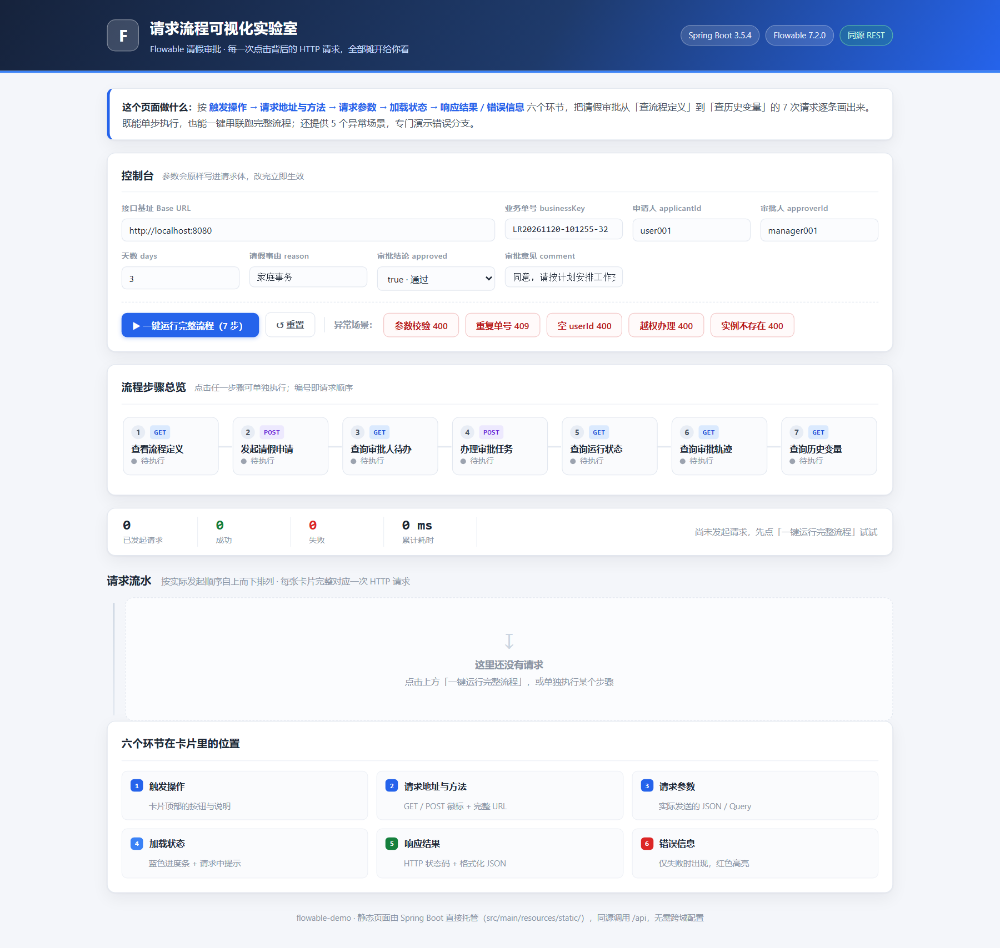

从上到下分五块，对应一次完整的操作动线：

1. **控制台**：接口基址、业务单号、申请人、审批人、天数、事由、审批结论、审批意见。这些值会**原样写进请求体**，改完点执行立即生效；
2. **流程步骤总览**：7 个节点横向排列，编号就是请求顺序，节点上标了 `GET` / `POST`、状态和耗时，点击任一节点可单独执行该步；
3. **汇总条**：已发起请求数、成功数、失败数、累计耗时；
4. **请求流水**：每发起一次请求就追加一张卡片，自上而下按真实顺序排列；
5. **环节对照表**：提示六个环节分别落在卡片的哪一段。

初始状态下流水是空的，提示「这里还没有请求」——这正是「环节 1 触发操作」之前的状态。

## 4、一张请求卡片的六个区域

以第 2 步「发起请假申请」为例：

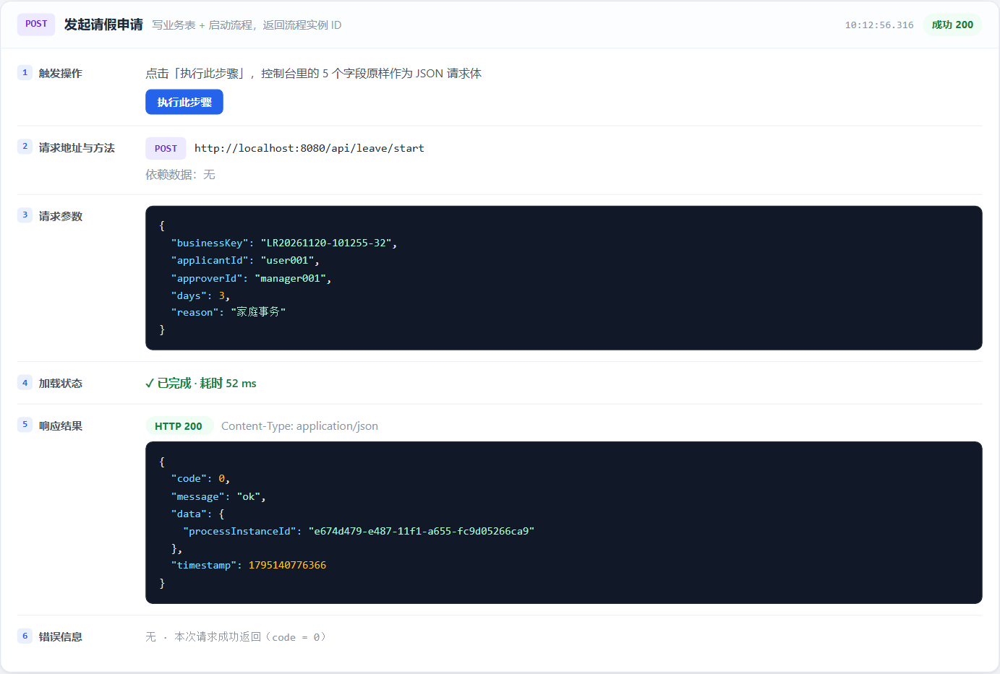

按编号对照，六个环节一目了然：

- **① 触发操作**：写明「点击『执行此步骤』，控制台里的 5 个字段原样作为 JSON 请求体」，下方就是可点的按钮；异常场景还会额外标出「预期」结果；
- **② 请求地址与方法**：`POST` 徽标 + `http://localhost:8080/api/leave/start`，下面一行标注依赖数据（本例为「无」）；
- **③ 请求参数**：深色代码块里是实际发送的 JSON，`businessKey`、`applicantId`、`approverId`、`days`、`reason` 五个字段清晰可读；
- **④ 加载状态**：`✓ 已完成 · 耗时 173 ms`，请求进行中时这里是蓝色进度条 + 「请求中…」；
- **⑤ 响应结果**：`HTTP 200` + 统一响应体 `ApiResult`，`code`、`message`、`data.processInstanceId`、`timestamp` 全部格式化展示；
- **⑥ 错误信息**：成功时显示「无 · 本次请求成功返回（code = 0）」，失败时换成红色错误框。

> 这里的 `processInstanceId` 就是下一步查状态、查历史的入参，页面会自动记住它。

## 5、逐步操作：7 次请求走完一条审批流程

下面按真实操作顺序，一步一步点。每一步都标注它对应请求流程中的哪个环节。

### 5.1 第 1 步：查看流程定义

对应环节：**② 请求地址与方法 + ⑤ 响应结果**。

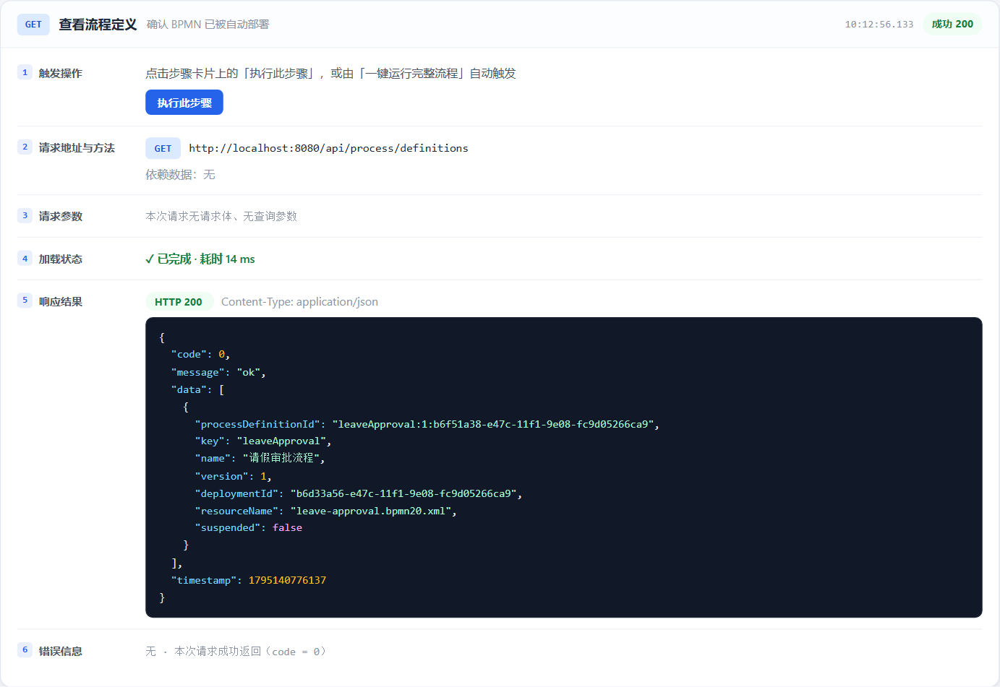

点击总览里的「1 查看流程定义」或卡片上的「执行此步骤」，发出 `GET /api/process/definitions`。响应里能看到 `key=leaveApproval`、`version=1`、`resourceName=leave-approval.bpmn20.xml`，说明 BPMN 已被自动部署。

这一步没有请求体，所以环节 ③ 显示「本次请求无请求体、无查询参数」——**空参数也是一种需要被明确展示的状态**，而不是留白让人猜。

### 5.2 观察加载状态

对应环节：**④ 加载状态**。

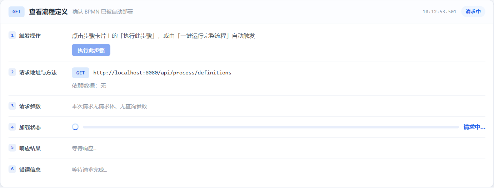

页面正常运行时请求只要十几毫秒，肉眼很难看清「请求中」。打开 <http://localhost:8080/?slow=1> 会进入教学慢速模式：每次请求前人为等待 1.2 秒，加载区就会持续显示蓝色进度条与「请求中…」，按钮同时禁用，避免重复提交。截图即来自这个模式。

加载结束后，同一区域会变成 `✓ 已完成 · 耗时 xx ms`；失败则是 `✗ 已完成（返回 400）`。

### 5.3 第 2 步：发起请假申请

对应环节：**③ 请求参数 + ⑤ 响应结果**。


`POST /api/leave/start`，请求体就是控制台那五个字段。成功后返回：

```json
{"code":0,"message":"ok","data":{"processInstanceId":"1bc9bde2-..."},"timestamp":...}
```

页面把 `processInstanceId` 存进上下文，供第 5、6、7 步使用。业务单号默认带时间戳（如 `LR20261120-100715-41`），避免反复操作时撞上唯一索引。

### 5.4 第 3 步：查询审批人待办

对应环节：**② 请求地址（带 Query 参数）+ ⑤ 响应结果**。


`GET /api/leave/tasks?userId=manager001`，响应 `data` 是一个数组，包含 `taskId`、`taskName=部门经理审批`、`processInstanceId`、`assignee=manager001`、`createTime`。页面从数组里按 `processInstanceId` 匹配出本次流程的任务，把 `taskId` 交给第 4 步。

> 如果审批人名下还有别的历史待办，这里会返回多条，页面仍会按 `processInstanceId` 精确匹配，不会张冠李戴。

### 5.5 第 4 步：办理审批任务

对应环节：**① 触发操作 + ③ 请求参数 + ⑤ 响应结果**。

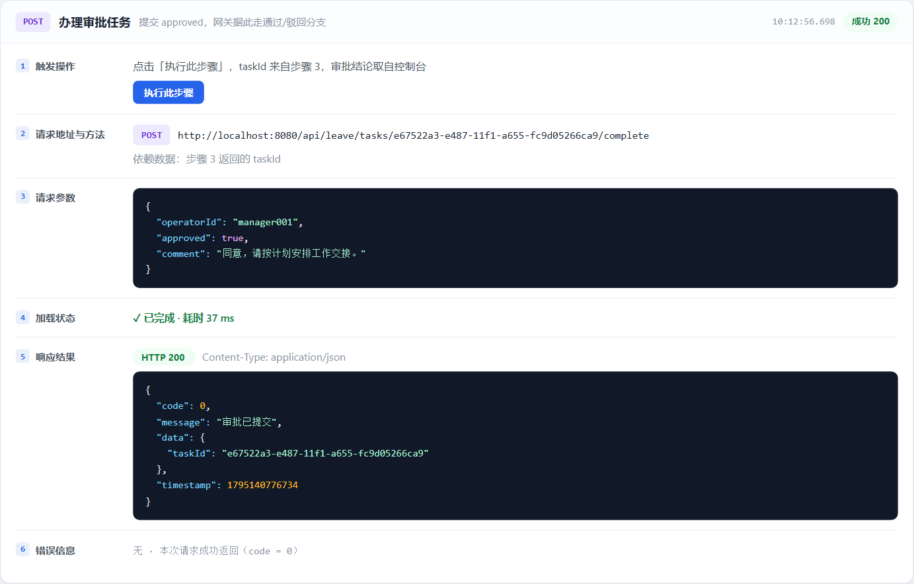

`POST /api/leave/tasks/{taskId}/complete`，请求体三字段：`operatorId`（必须等于任务 `assignee`）、`approved`（网关分支条件）、`comment`。

响应 `{"code":0,"message":"审批已提交","data":{"taskId":"..."}}`。此时 `approved=true` 已经写入流程变量，排他网关立刻走「审批通过」分支，流程结束。

### 5.6 第 5 步：查询运行状态

对应环节：**② 请求地址中的路径变量 + ⑤ 响应结果**。

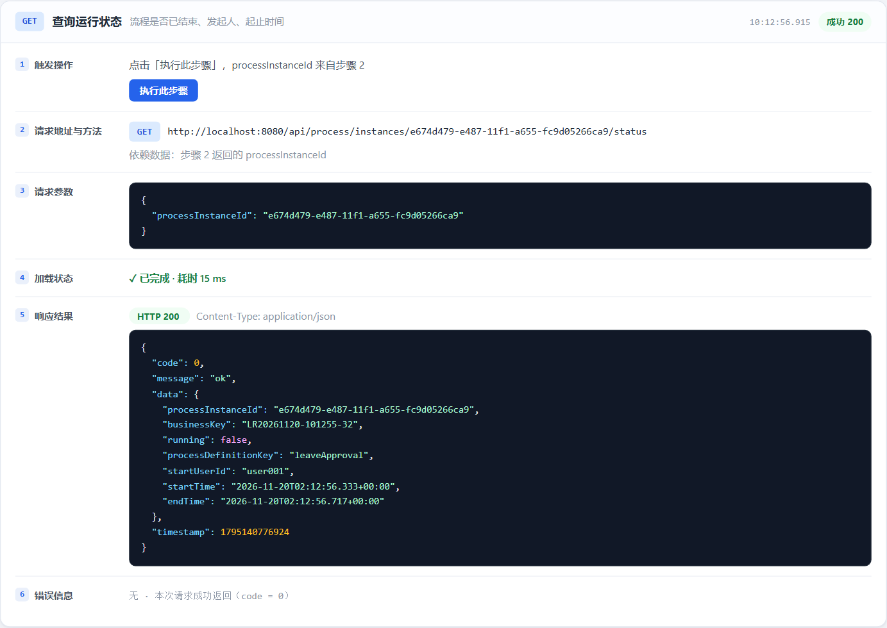

`GET /api/process/instances/{processInstanceId}/status`。响应里 `running=false`、`startUserId=user001`、`startTime` 与 `endTime` 都有值——说明流程确实走完，且发起人已写入历史（`ACT_HI_PROCINST.START_USER_ID_`）。

这是验证「审批真的生效」最直接的一屏：**不看日志、不查库，只看接口返回**。

### 5.7 第 6 步：查询审批轨迹

对应环节：**⑤ 响应结果（数组）**。

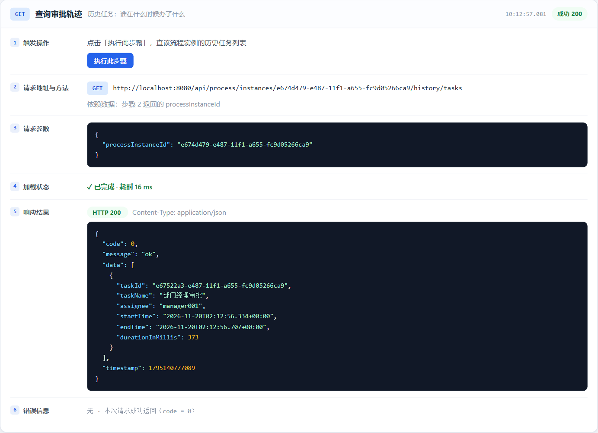

`GET /api/process/instances/{processInstanceId}/history/tasks`，返回历史任务列表：任务名、办理人、开始/结束时间、耗时。这条轨迹就是审批过程的审计证据。

### 5.8 第 7 步：查询历史变量

对应环节：**⑤ 响应结果（变量快照）**。

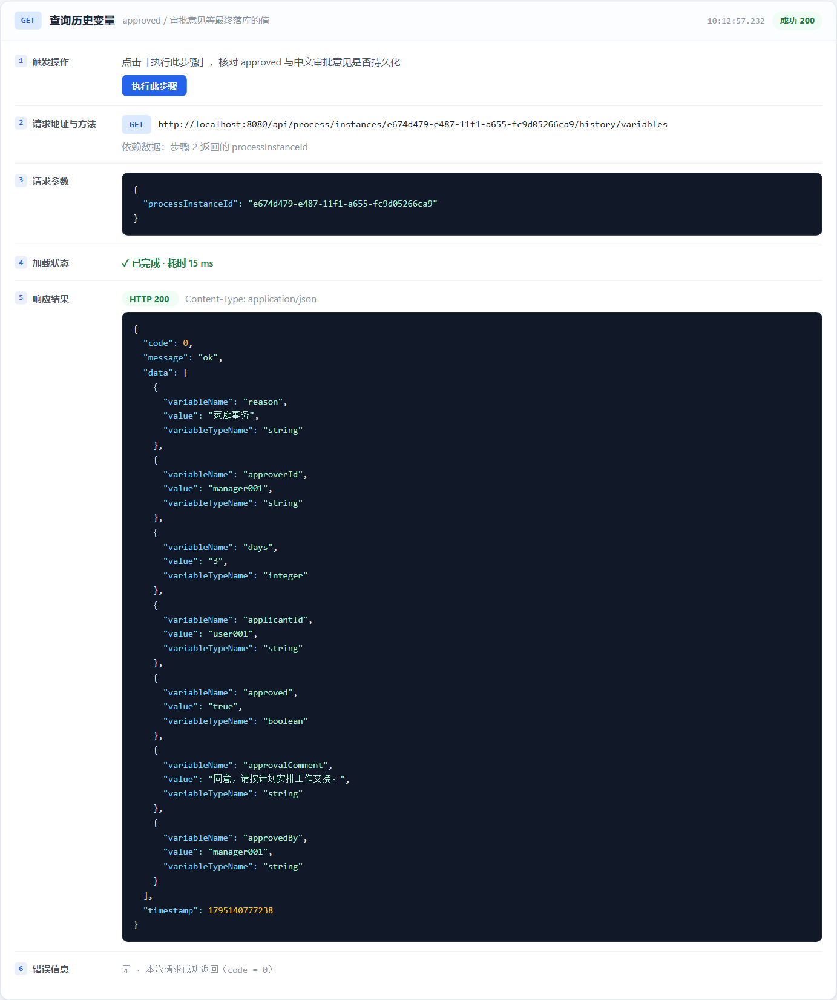

`GET /api/process/instances/{processInstanceId}/history/variables`，返回 `approved=true`、`approvalComment="同意，请按计划安排工作交接。"`、`applicantId`、`approverId`、`days`、`reason` 等最终落库的值，并附带 `variableTypeName`。

中文审批意见完整显示，顺带验证了字符集（utf8mb4）和 JSON 序列化没有问题。

## 6、一键运行：把 7 步串成一条时间线

对应环节：**各步骤顺序**。

不想一步步点时，直接点「▶ 一键运行完整流程（7 步）」。页面会按 1→7 的顺序串行发起请求，自动传递 `processInstanceId` 和 `taskId`，每步之间留 180 ms 间隔便于观察。

跑完后，步骤总览变成 7 个绿色节点，每个节点都带耗时：

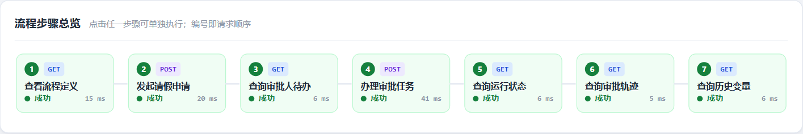

完整流水见下方长图（7 张卡片自上而下，序号即请求顺序）：

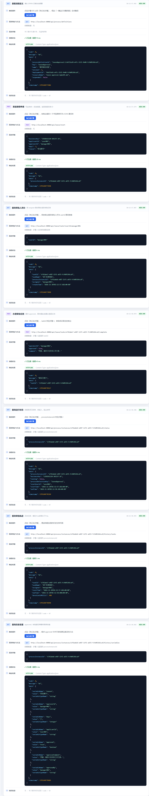

一键运行开始前会自动换一个新的业务单号，所以可以反复点；单步执行时不换号，重复执行第 2 步会得到 409——这正好是下一节的错误演示。

## 7、错误信息怎么读

错误场景按钮在控制台右侧，点击后会追加一张红色卡片，六个环节照样完整展示。

### 7.1 参数校验失败：400

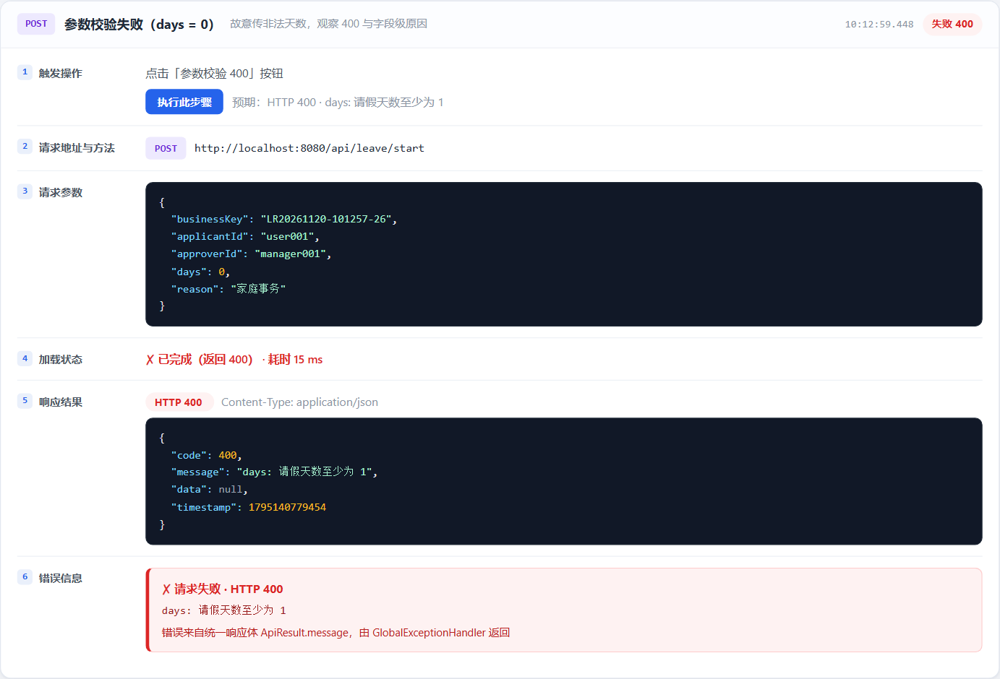

`days=0` 被 Bean Validation 拦下，响应体：

```json
{"code":400,"message":"days: 请假天数至少为 1","data":null,"timestamp":...}
```

要点：错误信息里带**字段名**，能直接定位是哪个参数不合法；HTTP 状态是 400 而不是 500。

### 7.2 重复业务单号：409

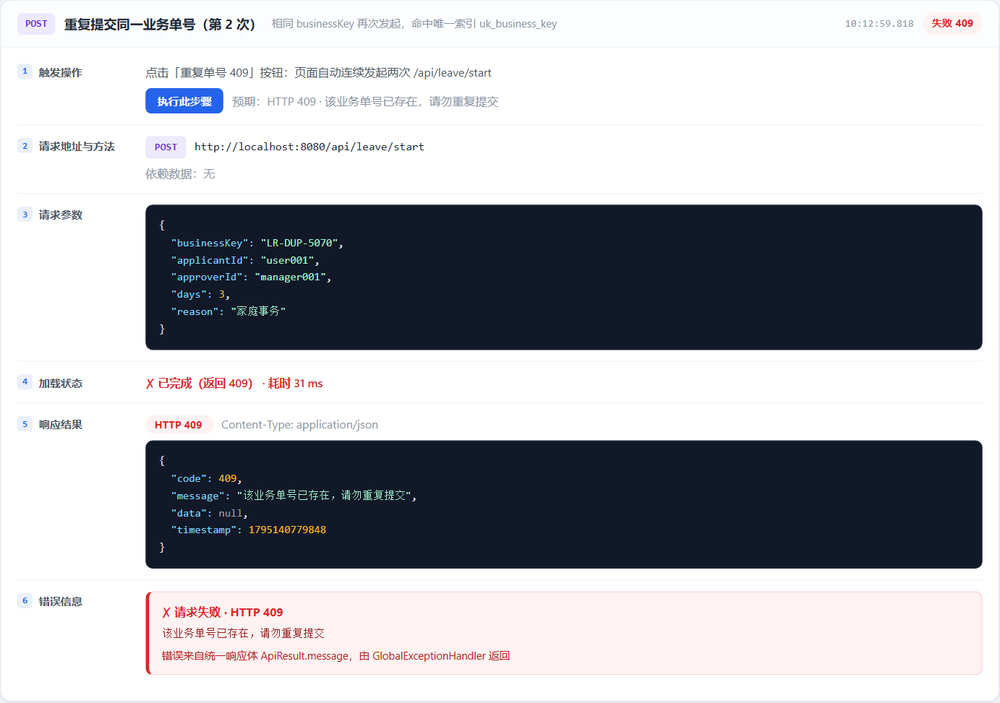

页面连续发两次相同 `businessKey` 的 `POST /api/leave/start`：第一次成功，第二次命中 `uk_business_key` 唯一索引，返回：

```json
{"code":409,"message":"该业务单号已存在，请勿重复提交","data":null,"timestamp":...}
```

这就是「唯一索引 + 事务」做幂等的实际表现，比「先查再启动」的预检查可靠。

### 7.3 网络层错误：fetch 抛异常

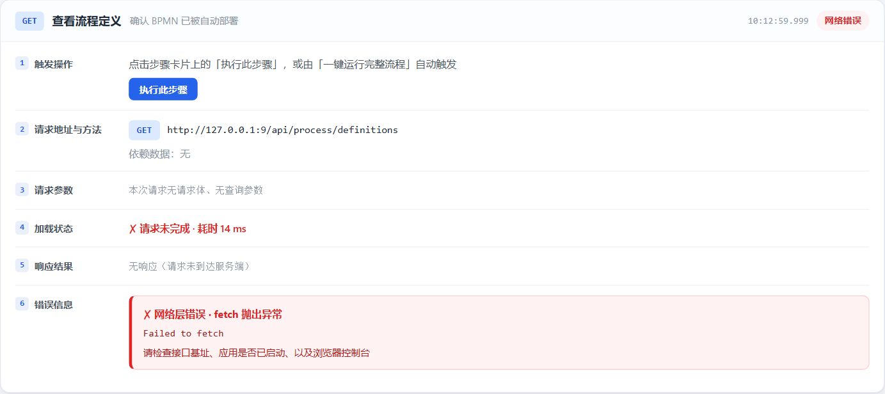

把接口基址改成不可达地址（如 `http://127.0.0.1:9`）再执行，请求根本到不了服务端。此时：

- 环节 ④ 显示「✗ 请求未完成」；
- 环节 ⑤ 显示「无响应（请求未到达服务端）」；
- 环节 ⑥ 显示 `Failed to fetch`，并提示检查基址、应用是否启动。

**HTTP 4xx 与网络异常是两类不同的问题**，页面分开展示，排查时不会混淆。

另外两个内置场景：`空 userId 400`（`userId 不能为空`）、`越权办理 400`（`任务不存在、已办理或当前用户无权办理`）、`实例不存在 400`（`流程实例不存在：NOT_EXIST`）。

## 8、七个步骤与请求环节对照表

| 顺序 | 页面操作 | 方法 | 请求地址 | 关键参数 | 预期结果 |
| --- | --- | --- | --- | --- | --- |
| 1 | 查看流程定义 | GET | `/api/process/definitions` | 无 | 200，`leaveApproval:1` |
| 2 | 发起请假申请 | POST | `/api/leave/start` | 5 个业务字段 | 200，返回 `processInstanceId` |
| 3 | 查询审批人待办 | GET | `/api/leave/tasks?userId=` | `userId` | 200，数组含 `taskId` |
| 4 | 办理审批任务 | POST | `/api/leave/tasks/{taskId}/complete` | `operatorId`/`approved`/`comment` | 200，`审批已提交` |
| 5 | 查询运行状态 | GET | `/api/process/instances/{id}/status` | 路径变量 `id` | 200，`running=false` |
| 6 | 查询审批轨迹 | GET | `/api/process/instances/{id}/history/tasks` | 路径变量 `id` | 200，历史任务数组 |
| 7 | 查询历史变量 | GET | `/api/process/instances/{id}/history/variables` | 路径变量 `id` | 200，含 `approved` |

这张表可以直接当接口调用顺序的备忘：**2 → 3 → 4 是主链路，5 → 6 → 7 是验证链路**，1 是启动自检。

## 9、常见问题

**Q1：页面打开是空白 / 404？**
确认静态资源已打进 jar：`jar tf target/flowable-demo-1.0.0.jar | grep static` 应看到 `index.html`、`app.js`、`app.css`。如果是 IDE 直接跑，确认 `src/main/resources/static/` 在类路径下。

**Q2：接口返回的时间比本地时间早 8 小时？**
后端 `Date` 默认按 UTC 序列化成 ISO-8601（如 `2026-11-20T02:09:18.745+00:00`），页面原样展示，不做时区转换。要显示为东八区，可在 `application.yml` 配置 `spring.jackson.time-zone: Asia/Shanghai`，但这会改变全局序列化行为，教程保持默认。

**Q3：`?slow=1` 是干什么的？**
教学用慢速模式，把每次请求人为延后 1.2 秒，方便观察和截图「加载状态」。正常使用去掉参数即可，不影响真实耗时统计（耗时从真正发起请求时开始计）。

**Q4：为什么单步执行第 2 步会报 409？**
业务单号没变。一键运行会自动换号，单步执行不会。想重复演示就先改一下控制台里的 `businessKey`，或点「重置」（重置也会换新号）。

**Q5：为什么第 5、6、7 步直接点会报 400？**
它们依赖第 2 步返回的 `processInstanceId`。没执行过第 2 步时，路径里是 `NOT_SET`，服务端返回「流程实例不存在」。按 1→7 顺序操作即可。

**Q6：待办列表里有多条任务，页面会不会选错？**
不会。页面按 `processInstanceId` 匹配本次流程，只有匹配不到时才退化为取第一条。多出来的通常是历史测试数据，可以用 `tools/capture_flow.py` 开头的清理逻辑或手动办理掉。

**Q7：为什么不用 Vue / React？**
这个页面的目标是「把请求过程看清楚」，不是做业务前端。原生 HTML/CSS/JS 零依赖、零构建，`java -jar` 就能跑，读者 clone 下来不用装 Node，也避免了 CDN 在离线环境失效。

## 10、怎么复现这些截图

截图脚本 `tools/capture_flow.py` 用 Playwright 驱动本机 Chrome，按真实点击顺序逐步截图：

```bash
python -m pip install playwright
python tools/capture_flow.py
```

脚本会：清理遗留待办 → 截加载态 → 截初始页 → 单步执行 7 次并逐张截图 → 重置后一键运行 → 截总览与完整流水 → 依次触发 400 / 409 / 网络错误并截图。产出全部落在 `docs/images/`，文件名与本文引用一一对应。
